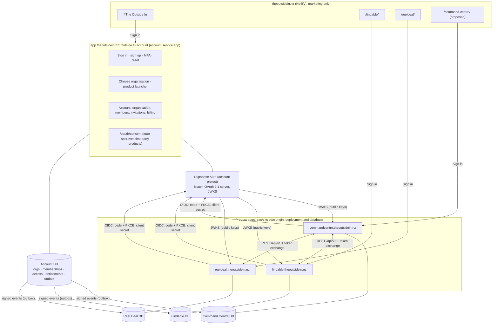

# The Outside In ecosystem: identity, domains and product access

**This is the single architecture document for identity across The Outside In.** Command Centre,
Findable and Reel Deal point here rather than keeping their own versions. `spec.md` holds the account
service's product requirements and data model; `schema-proposal.md` the proposed tables;
`environments.md` projects, settings and URLs per environment; `decisions.md` the dated decisions.

Every statement carries one of these labels:

| Label | Meaning |
|---|---|
| **Verified** | Checked in code, configuration or a live system, with the date |
| **Current** | What is built or deployed today (verified unless marked otherwise) |
| **Proposed** | Recommended design, not built, awaiting approval where marked |
| **Decided** | Approved by the owner, with the date |
| **[DECIDE]** | Needs an owner decision |

## 1. The ecosystem

**The Outside In** is the parent brand and ecosystem. It connects three products that each work on
their own and work better together:

| Product | What it does | Owns (system of record) |
|---|---|---|
| **Command Centre** | Business intelligence, strategy, marketing, projects, operations and the AI workforce | Workspaces, brands, strategy, intelligence, projects, campaigns, agents, approvals, reports |
| **Findable** | Tourism intelligence, discoverability (SEO, AEO, GEO) and performance insights | Visibility runs, answers, citations, website assessments, question coverage, content briefs, search data |
| **Reel Deal** | AI video, creative production, media intelligence and content workflows | Brand profiles (its copy), media, analysis, projects, storyboards, renders, exports, credits |
| **Account service** (this repository) | One Outside In identity: sign-in, organisations, memberships, product access, entitlements, billing | Users and credentials, MFA, sessions, organisations, organisation roles, memberships, invitations, product access, subscriptions, entitlements, platform staff, account audit |

Rules (**Decided**, 16–17 Nov 2026): one account for every product; separate product databases; a
product never stores another product's specialist records, only references and summaries; each
product keeps working when the others are not connected.

## 2. What exists today

### 2.1 Addresses (**Verified**, 22 Nov 2026, from the repositories' own records)

| Address | Serves | Hosting | Status |
|---|---|---|---|
| `https://theoutsidein.nz/` | The Outside In website (`anigemmill/outside-in-website`, Astro) | Netlify (`outsideinnz.netlify.app`); `www` redirects to the apex | Live |
| `https://theoutsidein.nz/findable/` | Findable's public pages (landing, how it works, pricing, about, free check, draft legal pages), part of the website | Netlify | Live (**confirmed URL**) |
| `https://theoutsidein.nz/reeldeal/` | **The whole Reel Deal app** (website pages *and* its app and sign-in pages), proxied by Netlify (status 200) to `https://reeldeal.theoutsidein.nz/reeldeal/`; Reel Deal is built with `basePath: /reeldeal` | Vercel project `reeldeal` behind the Netlify proxy | Website live since 21–22 Nov; **sign-in not open** (**confirmed URL**) |
| `https://reeldeal.theoutsidein.nz/reeldeal/` | Same Reel Deal deployment, directly | Vercel | Live (also answers) |
| `https://app.theoutsidein.nz/` | **Findable's production app** (`anigemmill/Tourism-AI-Growth-Platform`, `PRODUCT_BRAND=findable`), with live pilot operators, Google Analytics/Search Console connections (registered callback `https://app.theoutsidein.nz/api/integrations/google/callback`) and emailed account links | Vercel project `tourism-ai-growth-platform` (team ANI); database Supabase `hescoabpcjukmgeopjnq` | Live |
| `https://theoutsidein.nz/command-centre/` | Nothing yet | — | **Proposed** marketing URL, not implemented |
| Account service | Not deployed | — | Development only (`accounts-dev`) |

DNS for `theoutsidein.nz` is at Freeparking (Crazy Domains). Sources: `outside-in-website` `CLAUDE.md`
and `netlify.toml`; Reel Deal `docs/launch-domain.md`; Findable
`docs/findable-readiness/13-production-release-checklist.md` and
`docs/findable-readiness/15-google-oauth-verification.md`.

### 2.2 How each product signs people in today (**Verified**, 22 Nov 2026, from code and docs)

| Product | Sign-in | Users and organisations live in | Product access | Billing |
|---|---|---|---|---|
| Findable | Its own: email + password (scrypt), server-side sessions (hashed tokens, httpOnly `SameSite=Lax` cookie on `app.theoutsidein.nz`), TOTP two-factor, invitation-only (no sign-up), password reset, per-device sign-out | Its own Postgres (Prisma) in Supabase project `hescoabpcjukmgeopjnq`; `User` table mixing The Outside In's staff (`FOUNDER`, `ADMIN`, `PROGRAMME_MANAGER`, `ANALYST`) with customers (`OPERATOR`); businesses are `Operator`/`Business` rows linked by `UserBusiness`. It does **not** use Supabase Auth or the Data API | Roles + permission catalogue + per-user grants (`src/lib/rbac`), enforced server-side; operator data scoped to linked businesses on every request | Stripe, test mode, per business |
| Reel Deal | Its own Supabase Auth (project `reeldeal`, `jzshbaqfrrgsyiciuzfe`): email + password, cookie sessions via `@supabase/ssr`; built, **not yet open in production** (no Supabase keys in production; `SIGN_UP_OPEN` off) | Its own `organisations` and `memberships` (roles `viewer < editor < admin < owner`) in the `reeldeal` database, 0 users | Organisation membership and roles, RLS | Plan id on the organisation and a credit ledger; no Stripe |
| Command Centre | None built | None (M1 foundations only) | Specified only | Specified only |
| Account service | Account pages built and unit-tested (sign-up, sign-in, magic link, reset, TOTP, sign out everywhere, OAuth consent page), never run against real Supabase Auth | `accounts-dev` holds only the foundation migration (19 Nov) | Not built (A3–A4) | Not built (A9) |

**There is no central identity service in production anywhere today.** The account service is the
only one being built; nothing else in the repositories duplicates it.

### 2.3 Consequences

1. Findable already occupies `app.theoutsidein.nz`. Using that address as the shared entry point means
   Findable's app must move first, carefully (§5.4).
2. Reel Deal's app shares the origin `theoutsidein.nz` with the website. Its session cookies are sent
   with every request to the website, and a script running on the website runs with the same origin
   as Reel Deal's app pages (Reel Deal's `launch-domain.md` notes the shared cookies).
3. Reel Deal is about to open its **own** sign-in. Every account created there will have to be
   migrated later (§9). **Decided (D4, 22 Nov): it will not open standalone registration while the
   shared identity service is built.**
4. Findable's staff accounts and customer accounts are in one table; they separate into platform staff
   and organisation members when Findable moves (§9).

## 3. Target architecture (Proposed)



In words:

- **`theoutsidein.nz` stays the marketing site** for the parent brand and every product (`/findable/`,
  `/reeldeal/`, `/command-centre/`). Static pages; no product sessions.
- **`app.theoutsidein.nz` becomes the Outside In account**: the one place people sign in, choose an
  organisation, see and open their products, and manage their account, organisation, members,
  invitations and subscriptions. It is the account service's own app (Next.js, this repository), not a
  container for the products.
- **Each product runs as its own app on its own origin** under `theoutsidein.nz`, with its own
  deployment, database and security boundary, as an OpenID Connect client of the account service.
- **One sign-in** happens on `app.theoutsidein.nz`; opening any product afterwards is a redirect that
  comes straight back signed in (no second password, no prompt for first-party products).

### 3.1 Why separate origins for the product apps, rather than paths under one domain

The URLs you already use are paths (`/findable/`, `/reeldeal/`), and Next.js can serve several apps
under one host by path ("multi-zones", or a proxy like today's `/reeldeal`). That is the right tool for
**marketing pages**. For the **signed-in apps** it removes the browser's main protection between them:

| | Products on paths of one origin (e.g. `app.theoutsidein.nz/findable`) | Products on their own origins (e.g. `findable.theoutsidein.nz`) |
|---|---|---|
| Cookies | One cookie jar: every product's session cookies are sent to every other product (path scoping is not a security boundary) | Each product's cookies are host-only and never sent to another product |
| A security bug in one product (e.g. cross-site scripting) | Runs with the other products' origin: it can call their APIs with the person's cookies, read their pages | Contained to that product's origin; other products' sessions are out of reach |
| Content Security Policy, headers | Shared; the loosest product sets the bar | Per product |
| Independent deployment | Possible, but every app must agree on base paths and asset prefixes | Natural |
| Single sign-on | Works | Works the same (OIDC redirects) |
| URL the customer sees | One host | The account host plus each product's host |

All of these hosts are subdomains of one registrable domain, so they are "same-site": sign-in
redirects are seamless and `SameSite=Lax` cookies behave predictably. Because they are same-site,
cross-subdomain requests are **not** blocked by `SameSite`, so each product keeps its own CSRF
protection (Next.js server actions' origin check, already in Reel Deal and Command Centre).

**Decided (D2, 22 Nov 2026):** paths for marketing, separate origins for signed-in apps.

### 3.2 Routing summary (Proposed)

| What the customer does | Where they go |
|---|---|
| Reads about a product | `theoutsidein.nz/<product>/` |
| Clicks "Sign in" on a product page | That product's app, which redirects to `app.theoutsidein.nz` to sign in if needed, then back |
| Goes to `app.theoutsidein.nz` directly | Signs in, picks an organisation if they have several, sees a launcher of the products that organisation has (subscribed ones open; others show "Add to your plan") |
| Switches product inside an app | Product switcher (A7) opens the other product's app; it comes straight back signed in |
| Manages account, organisation, members, billing | `app.theoutsidein.nz/account/…`, linked from every product's profile menu |
| Signs up | Only on `app.theoutsidein.nz`. Product pages link there with the product as a hint |

## 4. Identity and authentication

### 4.1 Supabase Auth vs the OAuth 2.1 server (**Decided**, 21 Nov 2026)

- **Supabase Auth** is the authentication provider (credentials, sessions, MFA): required.
- **The OAuth 2.1 server** makes the account project an OpenID Connect provider for the products:
  required for one login across separately hosted apps with per-product, revocable tokens. Off in
  `accounts-dev` until A2 step 3; on in production before Command Centre's first deployment.

The mechanism (**Decided**, 17 Nov 2026): each product is a registered OAuth client; authorization
code with PKCE plus a confidential client secret; products verify tokens offline with the JWKS; one
issuer per environment; products' own Supabase Auth stays locked. Supabase supports the authorization
code and refresh flows only (no client credentials). The feature is **beta**, free during the beta.

### 4.2 Sign-in

```
 Person         Product app (server)                 app.theoutsidein.nz + Supabase Auth
   │ open ───►  no product session
   │            redirect → Supabase /oauth/authorize?client_id=…&code_challenge=…&state=…&nonce=…
   │ ◄────────────────────────────────────────────── /oauth/consent on app.theoutsidein.nz
   │            not signed in there? sign in (password, link, MFA) on app.theoutsidein.nz
   │            first-party client → approved without a prompt
   │            ◄──── redirect to the product's registered callback with code + state
   │            check state; exchange code (PKCE verifier + client secret), server to server
   │            ◄──── access token (15 min), refresh token, ID token
   │            verify ID token (nonce) once; verify access token (§6); store both in an encrypted,
   │            httpOnly, Secure, host-only cookie on the product's own origin
   │ ◄── app    every request: verify the access token offline; authorise from the local mirror
```

### 4.3 Sessions (Proposed)

| Session | Lives | Lasts | Holds |
|---|---|---|---|
| Account session | `app.theoutsidein.nz`, Supabase Auth cookies, httpOnly | Until sign-out or refresh-token expiry (inactivity timeout in production: to be reviewed under D7) | The person's main sign-in. Only the account app ever sees it |
| Product session | Each product's own origin, one encrypted httpOnly cookie | Access token 15 min, refreshed server-side with the product's refresh token | That product's tokens only. Never readable by browser JavaScript, never sent to another product |

The account session is never shared with a product, so a compromised product cannot act on the
account pages or in another product.

### 4.4 Sign-out (Proposed)

| Action | Effect |
|---|---|
| Sign out in a product | Clears that product's cookie and revokes its refresh token. The account session and other products stay signed in (**Decided** D6) |
| Sign out everywhere (account page) | Ends the account session and revokes all refresh tokens, including the products' (**to verify** that Supabase revokes OAuth-client refresh tokens with a global sign-out); publishes `session.revoked`; each product drops its sessions for that person on receipt. Remaining risk: an access token already issued stays valid until it expires (at most 15 minutes), so products also check the mirror for revoked sessions on sensitive actions |
| Removed from an organisation | `membership.removed` event; the product refuses that organisation on the next request, whatever the token says |

OpenID Connect front-channel or back-channel logout is not documented for Supabase's OAuth server
(**unverified**), so sign-out propagation relies on our own events.

### 4.5 Organisation selection (Proposed)

Tokens identify the **person**, not an organisation. After sign-in, `app.theoutsidein.nz` asks which
organisation (only if there are several) and opens products with it in the URL; each product resolves
the organisation from its URL (`/{orgSlug}/…`) against its mirror of memberships on every request.
Organisation and product claims in tokens would need a Custom Access Token Hook and would go stale
between refreshes, so they are left out at first; authorisation never depends on them.

### 4.6 Redirect validation

| Redirect | Rule |
|---|---|
| OAuth callback (`redirect_uri`) | Each client registers exact callback URLs per environment; dynamic registration off. Supabase checks the request's `redirect_uri` against them (**to verify** exact matching in A2 step 3, including that wildcards are refused) |
| After sign-in on the account pages | Same-site relative paths only (**built**, `src/lib/auth/redirects.ts`) |
| Email links | Only to the account app (Supabase URL allow-list: `app.theoutsidein.nz/**` in production) |
| Inside a product (return to the page you were on) | Same-origin relative paths only; `state` is bound to the browser and single-use |

## 5. Organisations, product access and entitlements

### 5.1 Model (Proposed in detail in `schema-proposal.md`)

| Layer | Question | Owned by | Checked where |
|---|---|---|---|
| Identity | Who is this? | Account service (Supabase Auth) | Token verification in each product |
| Organisation | Which organisations, with which organisation role (`owner`, `admin`, `member`, `billing`)? | Account service | Product mirror + RLS |
| Product access | May they open this product for this organisation? | Account service | Product mirror + RLS |
| Entitlements | What does this organisation's plan allow here? | Account service (computed from subscriptions) | Product service layer (`requireEntitlement`) |
| Product permissions | What may they do inside the product? | Each product | Product service layer + RLS |

Organisation records, memberships, product access and entitlements are mastered once and copied to
each product by signed, ordered, idempotent events with nightly reconciliation, so no product request
depends on a live call to the account service. A product receives only its own product access and
entitlements.

### 5.2 Product registration (Proposed)

Each product (and any future product) is registered once per environment: a product key
(`command_centre`, `findable`, `reel_deal`, …), an OAuth client id and secret, exact callback URLs, its
event endpoint and signing secret, and its plans. Adding a product to the ecosystem is a registration,
not a code change in the other products.

### 5.3 Customer journey (Proposed)

1. Create an Outside In account on `app.theoutsidein.nz` (or arrive from a product page, which links
   there with the product as a hint).
2. Create an organisation, or accept an invitation to one.
3. See the organisation's products in the launcher.
4. Subscribe the organisation to one product or a bundle (billing in the account app, A9).
5. Open any subscribed product; move between them with the product switcher, without signing in again.
6. Every product recognises the same person and organisation (same ids everywhere).
7. Each product checks its own permissions and entitlements on every request.
8. Each product keeps its own data; nothing crosses except through the documented APIs.
9. Account, organisation, members and subscriptions are managed in one place, `app.theoutsidein.nz`.

### 5.4 `app.theoutsidein.nz` as the entry point: how to get there (Proposed)

Findable is live on that address today, so it changes in steps, each separately approved:

1. Build and test the account service in development (`accounts-dev`, localhost).
2. Give Findable's app its own address, `findable.theoutsidein.nz` (**Decided** D5), alongside
   `app.theoutsidein.nz`: add the domain in Vercel, add the new Google OAuth callback next to the old
   one (the authorised domain `theoutsidein.nz` already covers subdomains), switch Findable's
   `APP_URL`, update the website's `findableAppUrl`. Keep `app.theoutsidein.nz` serving Findable while
   emailed links and bookmarks age out.
3. Deploy the account app (production) and move `app.theoutsidein.nz` to it, with permanent
   redirects for Findable's old paths (`/login`, `/invite`, `/reset-password`, the Google callback) to
   Findable's new address.
4. Move Findable's sign-in to the account service (§9).

Alternative with no Findable move: keep Findable on `app.theoutsidein.nz` and put the account app on
`account.theoutsidein.nz`. Simpler and safer short term, but the shared entry point would not be
`app.`. **Not chosen**: D1 (22 Nov) keeps `app.theoutsidein.nz` for the account app.

The full migration plan: `integrations/findable-migration.md`.

## 6. Token validation

### 6.1 What is verified and what is not (22 Nov 2026)

| Item | Status | Source |
|---|---|---|
| Issuer string `https://egtlqrmujhxelczbyszj.supabase.co/auth/v1` (development) | **Verified** (21 Nov) | `accounts-dev` OpenID discovery document |
| Signing key ES256 (P-256), published in the JWKS with a `kid` | **Verified** (21 Nov) | `accounts-dev` JWKS |
| Grant types authorization code + refresh only; response type `code`; scopes `openid profile email phone offline_access` | **Verified** (21 Nov) | Discovery document |
| OAuth server off in `accounts-dev` | **Verified** (21 Nov) | The authorization-server endpoint answers "OAuth server is disabled" |
| Access tokens are Supabase JWTs carrying `sub` (user id), `role`, `client_id` | **Documented by Supabase, not verified** | Supabase OAuth 2.1 server guide |
| `aud` value on OAuth access tokens (expected `authenticated`) | **Not verified** | — |
| `amr` / `aal` (MFA level), `session_id`, `exp` = issue + 900 s | **Not verified** | — |
| ID token claims, its signing algorithm, `nonce` handling | **Not verified.** The discovery document lists more than one ID-token algorithm, including at least one beginning "H…" (truncated in the check), so products must not accept whatever the token header says | Discovery document |
| Refresh tokens rotate; reuse after rotation is rejected | **Not verified** | — |
| `redirect_uri` exact matching | **Not verified** | — |
| Global sign-out revokes OAuth clients' refresh tokens | **Not verified** | — |

All "not verified" rows are checked with a real token in **A2 step 3**, and the results recorded here.
Until then no product code relies on them.

### 6.2 What every product verifies (Decided 21 Nov for `client_id`; rest Proposed)

1. **Signature** with the account service's JWKS, fetched from the discovery document, cached, and
   re-fetched on an unknown `kid` (key rotation). **Algorithm allow-list: ES256 (and RS256 if the
   project ever moves to it). Refuse `none`, every HS* algorithm, and anything else**, whatever the
   token header claims.
2. **`iss`** exactly equal to the environment's issuer. A development token is refused by production
   and vice versa.
3. **`client_id`** exactly equal to this product's OAuth client id in this environment. A token issued
   to another product, or with no `client_id` (for example the account pages' own session token), is
   refused. **`aud` is not used to tell products apart**: Supabase leaves it generic unless a Custom
   Access Token Hook rewrites it. If such a hook is added later, check both.
4. **`exp`** in the future and `iat`/`nbf` not in the future, with at most 60 seconds of clock skew.
5. **`sub`** is a UUID. Then authorisation from the local mirror only: membership of the organisation
   in the URL, product access, entitlements and product role. Other claims are hints for display.
6. Tokens are accepted only from the product's own session cookie or an `Authorization` header from a
   server; never from URLs or browser storage.
7. Run the request's queries as the user (`set local role authenticated`, `request.jwt.claims`), so
   RLS applies (**proven** in Command Centre's M1 database tests).

This verifier is the same in every product, so it is written once in the shared foundation package
(with the migration target guard and the design tokens) and tested against a local issuer.

### 6.3 Security implications of cross-product authentication

| Risk | Mitigation |
|---|---|
| A product's token replayed at another product | `client_id` check (§6.2 step 3) |
| A product's token used against the **account service's own Data API** (Supabase accepts OAuth tokens there, with RLS applied) | Account service RLS assumes any product, or a stolen product token, may call it as the person: no customer writes through the Data API, reads limited to what the person may see; consider removing `public` from the account project's exposed schemas (to decide in roadmap step 3; `security-review.md` F3) |
| A product's client secret leaks | It cannot mint tokens (asymmetric keys); it allows code exchange only for that client after a real sign-in. Rotate the secret; secrets live only in each product's host secret store |
| A compromised product | Separate origins (§3.1), separate databases, its own tokens only; the account session and other products are out of reach |
| Account service down | Signed-in people keep working (offline verification, mirrors); new sign-ins wait |
| Mirror lag after removing someone | Events within seconds; nightly reconciliation; 15-minute access tokens |
| Shared cookies on `theoutsidein.nz` (Reel Deal today) | Serve Reel Deal's signed-in app from its own origin when it joins the shared account (§12 D3) |
| OAuth server is beta | Products depend only on standard OIDC (discovery, JWKS, code + PKCE). Fallback that keeps one identity: products call the account project's Auth directly with `supabase-js` (weaker isolation; `decisions.md`, 21 Nov 2026) |

## 7. Product integrations

- **Acting for a signed-in person** (Command Centre fetching that person's Findable results): token
  exchange through the account service, with the target product's `client_id`.
- **Background work** (an agent's scheduled run): short-lived **service tokens** signed by the account
  service with its own separate key, naming the organisation and `on_behalf_of` (A5). Never a database
  key shared between products.
- Contracts, scopes and events between products: Command Centre `docs/specs/07-integration-contracts.md`
  and `docs/specs/06-auth-and-permissions.md` §6.

## 8. Environments

| Environment | Account (Auth + app) | Products | Data |
|---|---|---|---|
| Local | Local Postgres; tests set verified claims directly; optional local Supabase Auth runner | Each product's local setup | Synthetic |
| Development | `accounts-dev` (Supabase `egtlqrmujhxelczbyszj`); account app on `http://localhost:3100` | Localhost ports: Command Centre 3000 **[proposed: Reel Deal 3001, Findable 3002]** | Synthetic only, never copied from production |
| Staging | None yet. If added: its own account project and its own product projects, never shared | — | Synthetic |
| Production | `accounts-prod` (paid organisation); account app on `https://app.theoutsidein.nz` (**Decided** D1, after Findable's move) | Each product's production host | Real |

Separation rules (**Decided**): development and production never share a project, keys, OAuth
clients or secrets; each product accepts exactly one issuer per environment (tested); no production
data in development; each product's migration runner refuses any other product's database
(`src/server/db/migration-target.ts`, shared). Cloud development sessions reach only development hosts.

## 9. Migration of existing customers (Proposed; nothing migrated)

Order (**Decided**, 17 Nov): build and test the account service with Command Centre; move a staging
copy of Findable and test; switch Findable production at a quiet time agreed with Te Puia, keeping the
old sign-in available for a week; then Reel Deal.

| Product | Who | What happens |
|---|---|---|
| Command Centre | Nobody yet | Built on the shared account from the start (M2b) |
| Findable | Pilot operators and Te Puia; The Outside In staff | Each business becomes an organisation (ids preserved); `UserBusiness` links become memberships; staff become **platform staff**, not members. Passwords: scrypt hashes probably can't be imported into Supabase Auth (**unverified**), so people set a new password through an emailed link; TOTP factors are re-enrolled. Findable's Stripe billing moves to the account service later (A9). The pilot deployment can keep its own sign-in until the pilot ends |
| Reel Deal | Nobody yet (sign-in not open) | If it joins before opening sign-in: no migration at all. If it opens its own sign-in first: import its Supabase Auth users and organisations with ids preserved, then lock its Auth. **Decided (D4): it waits**, so no migration is expected |

Duplicate people (the same email in two products) are merged only by verified email, after the person
signs in, never silently.

## 10. Gaps between today and the target

| Gap | Where | Needed for |
|---|---|---|
| Account service A2 end-to-end, A3 organisations, A4 product access, A5 tokens and service tokens, A6 events, A7 product switcher, A8 staff support, A9 billing | Account service | Everything |
| Real-token verification of §6.1 | Account service A2 step 3 | Product verifiers |
| Shared token verifier package | Shared foundation | Every product |
| Command Centre OIDC client, session, mirrors (M2b) | Command Centre | Command Centre sign-in |
| Findable: OIDC client, mirrors replacing its own `User`/`UserBusiness` for sign-in, own address, external API and webhooks | Findable | Findable on the shared account |
| Reel Deal: OIDC client, mirrors for `organisations`/`memberships`, signed-in app on its own origin | Reel Deal | Reel Deal on the shared account |
| `app.theoutsidein.nz` handover (§5.4) | Hosting, DNS | The shared entry point |
| `theoutsidein.nz/command-centre/` pages | Website | Command Centre marketing |

## 11. Implementation sequence

The roadmap is kept in one place: `plan.md` (revised 22 Nov 2026 to the owner's order, with the
dependency review). Product plans: `integrations/command-centre.md` (first integration),
`integrations/reel-deal.md`, `integrations/findable-migration.md`. Security gate:
`security-review.md`.

Nothing in this document changes DNS, hosting, Auth settings or production data; each step is approved
separately.

## 12. Decisions (approved by the owner, 22 November 2026)

These are approved **architectural directions**, not approval to change DNS, hosting or production.

| # | Decision |
|---|---|
| D1 | `app.theoutsidein.nz` will ultimately become the central Outside In account service, **after Findable has been safely migrated** off it |
| D2 | Signed-in product applications run on **separate origins** |
| D3 | Reel Deal's signed-in application uses **`reeldeal.theoutsidein.nz`** |
| D4 | Reel Deal does **not** open standalone customer registration while the shared identity service is being developed |
| D5 | Hostname convention adopted (table below) |
| D6 | Product-level sign-out and global sign-out are **distinct** behaviours |
| D7 | A secure session policy is developed; the proposed 30-day inactivity timeout and MFA requirements are **reviewed before they are implemented** |

### Approved hostnames (D5)

| Address | Purpose | Today |
|---|---|---|
| `theoutsidein.nz` | Parent website | Live (Netlify) |
| `theoutsidein.nz/findable/` | Findable marketing | Live |
| `theoutsidein.nz/reeldeal/` | Reel Deal marketing | Live (currently also serves Reel Deal's app pages) |
| `theoutsidein.nz/command-centre/` | Command Centre marketing | Not built |
| `app.theoutsidein.nz` | Central Outside In account service, after Findable's migration | Findable's live app today |
| `findable.theoutsidein.nz` | Findable application | Not set up |
| `reeldeal.theoutsidein.nz` | Reel Deal application | Exists (Vercel), behind the website proxy |
| `commandcentre.theoutsidein.nz` | Command Centre application | Not set up |

### Still open

| # | Question | Where |
|---|---|---|
| O1 | Session policy values (inactivity timeout, MFA for owners and admins) | D7 review, before production |
| O2 | Account project's Data API exposure | Roadmap step 3; `security-review.md` F3 |
| O3 | Real token claims (`aud`, `amr`/`aal`, lifetimes, refresh and revocation behaviour) | Roadmap step 2 |
| O4 | Cost of `accounts-prod` and production hosting | Before roadmap step 9 |
| O5 | Whether adding redirect URIs affects Findable's Google OAuth verification | Before Findable phase A |
