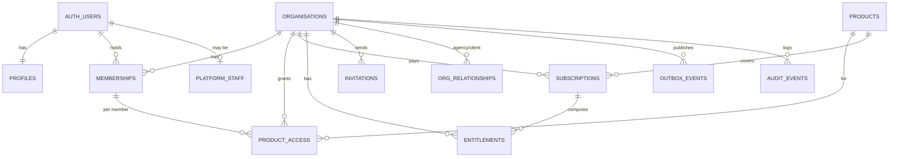

# Account service schema: proposal for review

Status: **proposed, 19 November 2026. Not a migration; nothing here is applied.** Covers build steps
A3 (organisations) and A4 (product access and plans) in `plan.md`. It refines `spec.md` §3 into
tables, keys, constraints and access rules. Choices that need the owner are marked **[DECIDE]**.

## 1. Principles

1. **One customer identity.** A person is one Supabase Auth user (`auth.users.id`) in every
   environment. Every product uses that id as its user id, and the organisation id below as its tenant
   id, so the same person and business are recognised everywhere without mapping tables.
2. **Identity and access only.** No workspaces, brands, projects, media, visibility runs or other
   product data. Each product keeps those in its own database (CLAUDE.md, `identity-architecture.md`).
3. **Every change is an event.** Any write to organisations, memberships, product access,
   subscriptions or entitlements also writes an outbox event in the same transaction (A6), so product
   mirrors stay correct.
4. **RLS on every table, deny by default**, with isolation tests per table. Customers read their own
   organisation's rows; writes go through audited server functions, never direct table writes.
5. **No secrets in rows.** Invitation tokens are stored as hashes; Stripe holds card data.

## 2. Entities

## 3. Tables

All in `public` unless noted; all have RLS. Timestamps are `timestamptz`, ids are `uuid` (random).

### Identity

| Table | Columns | Notes |
|---|---|---|
| `auth.users` | Supabase Auth | Credentials, email, MFA factors, sessions. Not altered by this service |
| `profiles` | `user_id` pk → `auth.users` on delete cascade, `display_name`, `avatar_url`, `locale` (default `en-NZ`), `time_zone` (default `Pacific/Auckland`), `theme` (`light` \| `dark` \| `system`), `created_at`, `updated_at` | One row per person. Locale, time zone and theme here so every product uses the same settings **[DECIDE: shared settings, Command Centre ecosystem doc §7]** |
| `platform_staff` | `user_id` pk, `role` (`support` \| `admin`), `granted_by`, `granted_at`, `revoked_at` | The Outside In's own people. **Not** organisation members. Support sessions (A8) come later |

### Organisations and memberships

| Table | Columns | Notes |
|---|---|---|
| `organisations` | `id`, `name` (1–120), `slug` unique, `kind` (`business` \| `agency` \| `enterprise`), `region` (default `ap-southeast-2`), `status` (`active` \| `suspended` \| `closing` \| `closed`), `billing_contact_user_id`, `created_by`, `created_at`, `updated_at` | The tenant in every product. `stripe_customer_id` is added in A9 |
| `memberships` | pk (`org_id`, `user_id`), `org_role` (`owner` \| `admin` \| `member` \| `billing`), `status` (`active` \| `suspended`), `delegated_from_org_id` null, `invited_by`, `joined_at` | At least one active `owner` per organisation (enforced by a constraint trigger). `delegated_from_org_id` marks agency staff working in a client organisation |
| `org_relationships` | `id`, `agency_org_id`, `client_org_id`, `status` (`pending` \| `active` \| `ended`), `requested_by`, `accepted_by`, `created_at`, `ended_at`; unique active pair | The client's owner accepts; ending it removes every delegated membership in the same transaction |

### Roles and permissions

Organisation roles are a fixed set here; detailed permissions inside a product stay in that product
(`identity-architecture.md` §3). This service only needs permissions for its own actions:

| Permission | owner | admin | member | billing |
|---|:-:|:-:|:-:|:-:|
| Close or transfer the organisation | ✓ | | | |
| Rename, change logo | ✓ | ✓ | | |
| Invite, remove, change organisation role | ✓ | ✓ (not owners) | | |
| Grant or remove product access | ✓ | ✓ | | |
| View and manage billing | ✓ | | | ✓ |
| See the member list | ✓ | ✓ | ✓ | ✓ |

Held as `app.org_permission(org_id, permission) returns boolean` (security definer,
`search_path = ''`), not as tables, until custom roles are needed **[DECIDE: fixed roles now, custom
roles later?]**.

### Products and product access

| Table | Columns | Notes |
|---|---|---|
| `products` | `key` pk (`command_centre` \| `findable` \| `reel_deal`), `name`, `client_id` (OAuth client per environment), `status` | Seeded. Products recognise their tokens by `client_id` (`identity-architecture.md` §2), so each environment's client id is stored here |
| `product_access` | pk (`org_id`, `user_id`, `product`), `product_role` text, `granted_by`, `granted_at` | May this member open this product for this organisation? `product_role` is the product's own role key (Command Centre `manager`, Reel Deal `editor`, …), validated against `products.roles` **[DECIDE: should accounts store product roles, or only "can open" with roles kept in each product?]** Foreign key to `memberships`, so access ends with membership |

### Subscriptions and entitlements

| Table | Columns | Notes |
|---|---|---|
| `plans` | `key` pk, `products text[]`, `kind` (`single` \| `bundle`), `status` | Mirrors each product's plan config (prices and limits stay in product config files) |
| `subscriptions` | `id`, `org_id`, `plan_key`, `status` (`trialing` \| `active` \| `past_due` \| `paused` \| `cancelled`), `period_start`, `period_end`, `cancel_at`, `source` (`staff` \| `stripe`), `stripe_subscription_id` null, `created_at` | A4: assigned by staff (`source = staff`); A9 adds Stripe. Manual and provider-confirmed records stay separate (billing rule) |
| `entitlements` | pk (`org_id`, `product`, `key`), `value jsonb`, `source` (`plan` \| `addon` \| `override`), `valid_until` | Computed from subscriptions by a server function on every subscription change; never edited by customers. Published as `entitlements.updated` |

### Invitations

| Table | Columns | Notes |
|---|---|---|
| `invitations` | `id`, `org_id`, `email_normalised`, `org_role`, `products jsonb` (product → role), `token_hash` unique, `invited_by`, `expires_at`, `accepted_by` null, `accepted_at` null, `revoked_at` null | One invitation covers every product. Token sent by email, stored as SHA-256. Single use; email must match on acceptance; seat limits checked at invite and at acceptance. Expiry 7 days **[DECIDE]** |

### Events and audit

| Table | Columns | Notes |
|---|---|---|
| `outbox_events` (schema `accounts_events`) | `id`, `org_id`, `seq` (per organisation, gap-free), `type` (`organisation.updated`, `membership.added`, `membership.removed`, `product_access.changed`, `subscription.changed`, `entitlements.updated`, `session.revoked`), `version`, `payload jsonb`, `created_at`, `published_at` | Written in the same transaction as the change. Never updated except `published_at`. Not exposed to customers |
| `audit_events` | `id`, `org_id` null (null for personal actions), `actor_user_id`, `actor_kind` (`user` \| `staff` \| `system`), `action`, `target_type`, `target_id`, `before jsonb`, `after jsonb`, `ip_hash`, `user_agent_hash`, `at` | Append-only (no update or delete grants). Sign-ins and MFA changes come from Supabase Auth's own audit log and are copied in |

## 4. Access rules (RLS)

| Table | Signed-in customer can read | Customer writes |
|---|---|---|
| `profiles` | Own row; display name of people in shared organisations | Own row: name, avatar, locale, time zone, theme |
| `organisations` | Organisations they are an active member of | None directly; server functions check `org_permission` |
| `memberships` | Their organisations' members | None directly |
| `product_access` | Own rows; all rows if owner or admin | None directly |
| `subscriptions`, `entitlements` | Their organisations' rows | None |
| `invitations` | Owner and admin of the organisation; never `token_hash` (column grant) | None directly |
| `audit_events` | Owner and admin of the organisation | None |
| `outbox_events`, `platform_staff`, `plans`, `products` | None (server only), except `products` readable by all | None |

Server writes run as a restricted role (like Reel Deal's `reeldeal_web`), never the service role.

## 5. What products receive

Products verify the token (identity) and then rely on their mirror, fed by events:

| Mirror in each product | From |
|---|---|
| `organisations` (id, name, slug, kind, status) | `organisation.*` events |
| `memberships` (org_id, user_id, org_role, status) | `membership.*` events |
| this product's `product_access` rows only | `product_access.changed` |
| this product's `entitlements` only | `entitlements.updated` |
| `profiles` (display name, locale, time zone, theme) | `profile.updated` **[if shared settings are approved]** |

A product receives only its own product access and entitlements, never another product's.

## 6. Not included (by design)

Workspaces, brands, locations, projects, media, credits ledgers, visibility data, product-specific
permissions, product usage detail. Product usage totals reach accounts only for billing, in A9.

## 7. Tests required with the migration

- Isolation for every table: a member of organisation A sees nothing of B; guessed ids; `org_id`
  changes refused.
- Last owner cannot be removed or demoted.
- Every write path writes exactly one outbox event in the same transaction (rolled back together).
- Invitation: expired, revoked, reused and wrong-email acceptances refused.
- Entitlements recomputed on every subscription change; customers cannot write them.
- `audit_events` cannot be updated or deleted by any runtime role.
